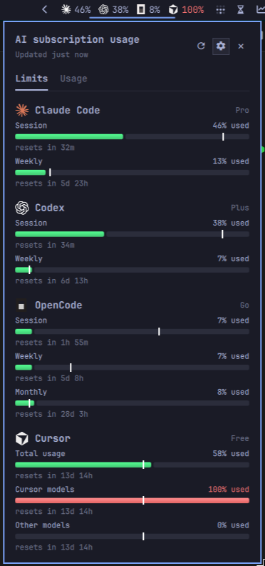
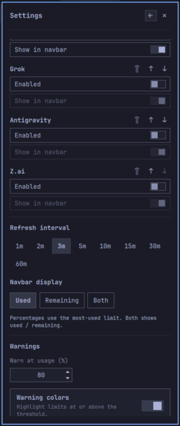
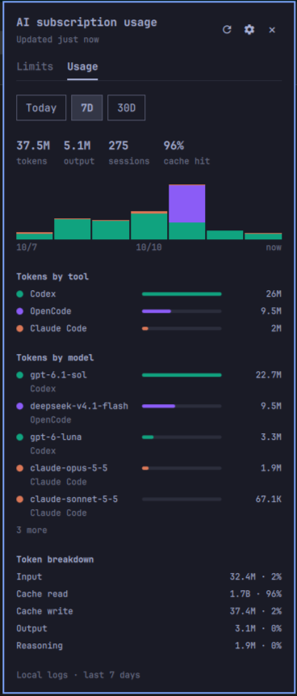

# AI usage for Omarchy

See how much of your AI coding subscription you've used without opening each
provider's dashboard. AI usage adds Claude Code, Codex, OpenCode, Cursor, Grok,
Antigravity, and Z.ai usage to the Omarchy bar, with a panel for plan limits,
reset countdowns, and locally-logged token usage.

```text
[claude] 42%  [chatgpt] 18%  [opencode] 7%  [cursor] 2%  [grok] 5%  [antigravity] 12%  [z.ai] 25%
```

The bar shows each provider's most-used limit. Hover the widget to see what
the percentages mean. Click it to see every available limit, your plan, and
when your allowance resets; the header shows how long ago the reading was
refreshed. The last reading is cached, so the bar fills in immediately after
a shell restart. The panel stays within 60% of the screen height and scrolls
when needed.





## User guide

### What you can do

- Track several providers in one place, using their existing local sign-ins.
- Choose which providers to collect and which to show in the bar.
- Reorder providers and show used percentage, remaining percentage, or both.
- Adjust refresh frequency and get optional notifications near your limits.
- Keep the last good reading visible when a provider cannot refresh, with a
  plain-language status and next step when one is known.

| Provider | Usage shown | Local usage |
| --- | --- | --- |
| Claude Code | Session and weekly limits | Yes |
| Codex | Session and weekly limits | Yes |
| OpenCode Go | Session, weekly, and monthly limits | Yes |
| Cursor | Total usage, Cursor models, and other models | No |
| Grok | Weekly shared pool and pay-as-you-go cap | No |
| Antigravity | Shared Gemini and Claude/GPT pools, rolling 5-hour and weekly windows | No |
| Z.ai | Session and weekly limits, and monthly web searches | No |

The limits view reports subscription allowances. The Usage tab reports local
token counts read from the tools' own logs. Neither estimates spending. A
supported subscription and a local sign-in are needed for each provider whose
limits you track; local usage counts whatever logs exist on the machine.

### Install

You need Omarchy with its Quickshell-based shell and plugin support, Git, and
Python 3. The collector uses only Python's standard library; there is no
package installation or separate background service.

Clone the repository into Omarchy's user plugin directory, then enable it:

```sh
mkdir -p "$HOME/.config/omarchy/plugins"
git clone https://github.com/nejcm/omarchy-ai-usage.git "$HOME/.config/omarchy/plugins/io.github.nejcm.ai-usage"
omarchy-shell shell rescanPlugins
omarchy plugin enable io.github.nejcm.ai-usage --section right
```

Sign in through the coding tools you use, then click the usage widget. Claude
Code and Codex are enabled initially; turn on the others in settings. A
provider without a usable sign-in shows `–` and a hint on how to connect.

If you already have a checkout, you can symlink its absolute path into the
same plugin directory instead of cloning it. Keep that checkout in place;
the shell loads the plugin from it.

### Settings

Click the cog in the panel's top-right corner. Changes apply and save
immediately. Back returns to the selected tab; Close dismisses the panel.
Reopening starts on Limits.

| Setting | Behavior | Default |
| --- | --- | --- |
| Enabled | Collect and display this provider | On for Claude Code and Codex |
| Show in navbar | Show this provider in the bar; keep its panel readings and notifications when hidden | On for all providers |
| Provider order | Move up, down, or to top to reorder both the bar and panel | Claude Code, Codex, OpenCode, Cursor, Grok, Antigravity, Z.ai |
| Refresh interval | 1, 2, 3, 5, 10, 15, 30, or 60 minutes | 5 minutes |
| Navbar display | Used %, remaining %, or both as `used / remaining` | Used % |
| Warn at usage | Global threshold from 1–100% used | 80% |
| Warning colors | Highlight limits at or above the threshold | On |
| Desktop notifications | Notify when a limit reaches the threshold | Off |
| Local token usage | Scan local logs and show the panel's Usage tab | On |
| Reset to defaults | Restore provider enablement, order, navbar visibility, refresh interval, and warnings. Reset shows a separate Confirm button; confirming within five seconds applies it | — |

Disabling a provider preserves its credentials and preferences. An already
running collection finishes safely, but its disabled results are discarded.
An `AI` button remains when every provider is hidden or disabled, so you can
still open settings.

Warnings use the percentage **used**, including when the bar shows remaining
allowance. Notifications fire once per limit period and remember that state
across shell restarts. Limits without a reset time can notify again after a
fresh reading falls below the threshold. Stale readings never trigger a
notification. Shorter refresh intervals make more requests and may encounter
provider throttling.

### Local token usage

The panel has two tabs: **Limits** (the default) and **Usage**. The Usage tab
reads the logs your coding tools already write on this machine and shows token
totals for Today, 7D (the default), 30D, 6M, and 1Y: a summary row, stacked
bars (per day for the short windows, per week for 6M and 1Y), totals by tool
and by model, and a token breakdown with each bucket's share. Choose **All**
or one enabled local source — Claude Code, Codex, or OpenCode — to scope
every figure to that tool's logs; the window choice stays independent, and
disabling the chosen tool returns the tab to All. The model list shows the five busiest entries with an **N more**
button that reveals the rest and becomes **Show less**. Each reading keeps
token counts, model IDs, session IDs, and timestamps. The cache also stores
each log's path — which can include project directory names — and its read
position so scans resume; prompt content is never stored. Cached reads stay out
of the headline and appear in the breakdown and the cache-hit share. Until the
first scan finishes, the tab says "Scanning local logs…". When a finished scan
finds nothing in the last year, the tab names the supported local sources
and offers **Open settings**; if the All view has data but the chosen tool does
not, it says so and offers **Show all**.

Turn the **Local token usage** setting off to hide the tab and stop scanning.
The scan follows the enabled providers and runs after each limit refresh,
whether or not the panel is open.

### Privacy and credentials

The plugin reads credentials already stored by your coding tools and contacts
only their providers. It has no separate account, sync service, or telemetry.
Credentials are never included in usage output, logs, or process arguments.
Settings and warning memory are saved in the plugin's Omarchy `shell.json`
entry.

Claude Code is the exception to read-only credential access: the plugin can
refresh an expired OAuth token and save the rotated credentials back to
Claude's credential file. Codex, Cursor, Grok, Antigravity, and Z.ai sign-in
renewal stays with their own tools. See [Claude OAuth refresh](#claude-oauth-refresh) for the safeguards.

| Provider | Local credential file | Environment overrides |
| --- | --- | --- |
| Claude Code | `~/.claude/.credentials.json` | `CLAUDE_CONFIG_DIR` |
| Codex | `~/.codex/auth.json` | `CODEX_HOME` |
| OpenCode | `~/.local/share/opencode/auth.json` | `XDG_DATA_HOME`, `OPENCODE_DATA_DIR` |
| Cursor | `~/.config/cursor/auth.json` | `XDG_CONFIG_HOME` |
| Grok | `~/.grok/auth.json` | `GROK_HOME` |
| Antigravity | `~/.gemini/antigravity-cli/antigravity-oauth-token` | — |
| Z.ai | `~/.chelper/config.yaml` (`api_key`), else the Z.ai `ANTHROPIC_AUTH_TOKEN` in `~/.claude/settings.json` | `CLAUDE_CONFIG_DIR` |

Local usage never contacts anything: it opens the tools' logs read-only and
aggregates the totals into `$XDG_CACHE_HOME/omarchy-ai-usage/usage.db` (default
`~/.cache/omarchy-ai-usage/usage.db`). The database is a cache: deleting it
rescans the surviving logs, so totals for logs a tool has already deleted are
lost. Events older than a year are pruned, and files untouched for a year are
skipped.

| Provider | Local log read |
| --- | --- |
| Claude Code | `~/.claude/projects/**/*.jsonl` |
| Codex | `~/.codex/sessions/**/*.jsonl`, `~/.codex/archived_sessions/**/*.jsonl` |
| OpenCode | `~/.local/share/opencode/opencode.db` (read-only) |

The `CLAUDE_CONFIG_DIR`, `CODEX_HOME`, and `XDG_DATA_HOME`/`OPENCODE_DATA_DIR`
overrides apply here too; no other paths are read.

### Troubleshooting

| Status | Meaning and next step |
| --- | --- |
| Not signed in | No usable local credentials. Sign in through that provider's coding tool. |
| Sign-in expired | Credentials need renewal. Run the provider's tool to refresh its login. |
| Stale | The latest refresh failed or is refreshing elsewhere. The panel keeps the last good reading and shows the error. |
| Unavailable | The account has no supported subscription data, such as a Codex API key or an OpenCode account without Go. |
| Rate limited | The provider returned HTTP 429. Increase the refresh interval. |
| Error | A credential file, provider response, or network request failed. Check the error shown in the panel. |

The panel shows known errors in plain language and, for the common ones, a
short next step such as which CLI opens to renew a sign-in or the settings
change for rate limiting. Hover a status line for the raw collector code;
providers that need sign-in add a link to this section in the panel and
settings, and settings shows the same connect hint next to each provider.

If the widget does not appear, run `omarchy-shell shell rescanPlugins` and
retry the enable command. The plugin runs inside the existing Omarchy shell;
do not start a second Quickshell instance to load it.

Some credential stores are not supported:

- OpenCode can move the Go key into a channel SQLite database. This plugin
  reads `auth.json` only; if the key is absent there, it shows not signed in.
- Cursor uses the CLI/agent credential file. The Cursor IDE's VS Code
  `state.vscdb` credential store is not read.
- Antigravity normally keeps its token in the OS keyring; only the plaintext
  `agy` fallback file (headless Linux) is read. If the keyring holds the token
  the provider shows not signed in.
- Z.ai has no key-entry UI here. It reads the key Z.ai's `chelper` CLI stores at
  `~/.chelper/config.yaml`, otherwise the `ANTHROPIC_AUTH_TOKEN` in
  `~/.claude/settings.json` when Claude Code is configured against Z.ai
  (`ANTHROPIC_BASE_URL` `https://api.z.ai/api/anthropic`).

### Update or disable

For an installation cloned using the commands above:

```sh
git -C "$HOME/.config/omarchy/plugins/io.github.nejcm.ai-usage" pull --ff-only
omarchy-shell shell rescanPlugins
```

To remove the widget from the bar without deleting the checkout or credentials:

```sh
omarchy plugin disable io.github.nejcm.ai-usage
```

To remove the installed plugin and its checkout:

```sh
omarchy plugin remove io.github.nejcm.ai-usage
```

## Contributing and development

### Project layout

| File or directory | Responsibility |
| --- | --- |
| `manifest.json` | Plugin identity and bar-widget entry point |
| `BarWidget.qml` | Collector process, cached readings, settings persistence, notifications, and bar rendering |
| `Panel.qml` | Usage panel, navigation, reset countdowns, and scrolling |
| `Settings.qml` | Provider controls and display/notification preferences |
| `LocalUsage.qml` | Usage tab: local token, tool, and model totals |
| `Model.js` | Shared formatting, provider selection, cache merging, and warning-period logic |
| `usage.py` | One-shot collector, CLI, and shared HTTP transport |
| `local_usage/scan.py` | Incremental local-log scan into the SQLite usage cache |
| `local_usage/claude.py` | Claude Code transcript source for the usage scan |
| `local_usage/codex.py` | Codex session-rollout source for the usage scan |
| `local_usage/opencode.py` | OpenCode database source for the usage scan |
| `local_usage/report.py` | Aggregates the usage cache into windowed token and model totals |
| `providers/` | Quota collection only: provider-specific credential readers and response parsers (the usage sources reuse its path and time helpers) |
| `tests/` | Offline tests and redacted provider fixtures |
| `assets/` | Provider logos, including white variants for dark backgrounds |

The shell invokes `usage.py` on load, at the chosen interval, and when the
panel opens with stale data. Only enabled providers are passed through
repeatable `--provider` arguments. No collector starts when all are disabled.
A second process runs `usage.py --usage` after each quota refresh while the
Local token usage setting is on, with its own timeout; its result stays on the
widget, not in the quota cache. Failed provider refreshes retain the last good
metrics and timestamp with a `stale` status. Navbar visibility affects
rendering only.

Settings use the host's `updateEntryInline` API. Warning state is saved before
notifications are sent; the host updates the same plugin's live instances
synchronously across monitors.

### Local development

Clone the repository wherever you work, then symlink that checkout into
`~/.config/omarchy/plugins/io.github.nejcm.ai-usage`. Rescan and enable it using
the installation commands above. Edit the checkout and use the existing shell
to check the bar, usage panel, and settings. There is no build step or package
manager setup.

You can inspect the normalized collector output directly:

```sh
python3 usage.py --pretty
python3 usage.py --provider codex --provider cursor --pretty
python3 usage.py --usage --pretty
```

These commands use your real local data. The quota commands read your
credentials and make provider requests; `--usage` reads local logs and writes
the usage cache without contacting anything. The Claude collector may rotate
and persist OAuth credentials. Use the offline tests when you want checks
without contacting providers.

### Tests and checks

```sh
python3 -m unittest discover tests
git diff --check
```

Tests use temporary credential files, redacted fixtures, and fake transports;
they do not contact providers or touch real credentials. Node.js runs the
JavaScript helper and extracted QML function tests when installed; those cases
are skipped if Node.js is unavailable. No npm dependencies are required.

For UI changes, also check the panel at smaller screen sizes, keyboard
navigation, all-disabled and all-hidden states, and changes during a refresh.
Use Qt 6 QML tooling rather than the Qt 5 binaries. A standalone QML test
runner may not load Quickshell's embedded plugin, so it does not replace a
check inside the running Omarchy shell.

### Adding a provider

1. Add a module under `providers/` with its identity, credential reader,
   allowed hosts, collector, and parser. Reuse `providers/common.py` for
   normalization and status mapping.
2. Register it in `providers/__init__.py`.
3. Add its order, name, and logo mapping in `Model.js`, plus logo assets.
4. Add redacted response fixtures and offline tests for success, missing or
   expired credentials, malformed responses, and provider errors.
5. Update the supported-provider and credential tables in this README.

Provider rows contain `provider`, `name`, `abbrev`, `plan`, `status`, `error`,
`metrics`, `resetAt`, and `refreshedAt`. Each metric contains `label`,
`percent`, `resetsAt`, and `windowMinutes`. Percent means usage consumed, clamped
to 0–100; unavailable percentages are omitted. Reset times use UTC ISO timestamps
or an empty string when unknown. `windowMinutes` is the limit window length, or
`null` when unknown; the panel uses it to mark elapsed time on the meter.

Keep provider differences inside their modules. Avoid new runtime dependencies
for transport or parsing, preserve existing credentials, and never commit
real tokens or unredacted responses.

### Transport safeguards

The shared transport uses a per-provider host allow-list, a 10-second default
timeout per socket operation, and no HTTP redirects. A run that exceeds 60
seconds is stopped by the bar widget with SIGTERM. Authorization headers
cannot be forwarded to another host. Errors use bounded codes rather than raw
server responses. Claude OAuth refresh can inspect a small response body to
recognize a rejected refresh; that body is not included in usage output.

| Provider | Allowed hosts |
| --- | --- |
| Claude Code | `api.anthropic.com`, `platform.claude.com` |
| Codex | `chatgpt.com` |
| OpenCode | `opencode.ai` |
| Cursor | `api2.cursor.sh` |
| Grok | `cli-chat-proxy.grok.com` |
| Antigravity | `cloudcode-pa.googleapis.com` |
| Z.ai | `api.z.ai` |

### Claude OAuth refresh

When Claude Code's access token is expired or the usage call returns 401,
the collector POSTs the refresh token to
`https://platform.claude.com/v1/oauth/token` and uses the rotated access
token. The whole rotation runs under Claude Code's own refresh lock
(`~/.claude/.oauth_refresh.lock`, the same directory lock `proper-lockfile`
uses with a 60-second stale window): the credential file is re-read under the
lock, and if another process already rotated it the new value is adopted
instead of refreshed. If the lock is already held, no refresh is attempted and
the row reads `refresh-locked` (shown as stale with the last good values).

The collector publishes an empty directory it already owns using Linux
`renameat2(RENAME_NOREPLACE)`, then updates its mtime through its descriptor
every five seconds during the exchange. It never removes the shared lock,
including stale locks. On release it stops and joins the heartbeat and marks
only its owned directory stale. Claude Code reclaims it; until then another
collector refresh returns `refresh-locked`.

The exchange runs in a child process with a 20-second deadline and up to one
second for cancellation. The child is killed if necessary and always reaped
before lock release. A completed response is recovered from anonymous memory
and persisted even if the child exits after the deadline. `refresh-timeout`
means no complete response was recovered; the server may already have rotated
the token, so run Claude Code to recover the login rather than retrying here.

SIGTERM is blocked from before the refresh lock is taken until the rotation is
persisted and the lock released, so the widget's 60-second stop never discards
a rotated token; that window is bounded by the 20-second deadline plus
cancellation. A shell reload or widget teardown kills the collector with
SIGKILL, which can still lose an in-flight rotation.

A successful rotation is written back to `~/.claude/.credentials.json`: all
other keys are preserved, the write is a temp file in the same directory at
mode `0600` followed by `os.replace`, and the whole `claudeAiOauth` object is
compared before the temp write and again immediately before `os.replace`.
Once the exchange succeeded the rotation is saved even if the lock was lost,
since the old refresh token is already dead. If the write fails the row is an
error (`persist-write-failed`), never `ok`. This is the only token this plugin
ever persists; it is never logged or passed on the command line. An invalid
refresh expiry is ignored while the rotated tokens are saved.
